# **Taller de Proyecto II - Grupo A1** 

## **Bitácora** 

**Sistema de Acceso Vehicular Seguro (Rolling code con AES-128)** 

### **Grupo de Desarrollo** 

- Gonzalez Seijas, Juan Blas – 03113/7 

- Lumbreras, Valentin – 02684/7 

- Medina, Alan – 01551/9 

#### **Fecha 27/08/2026** 

- Qué se hizo? 

   - Asignación del tema del proyecto por parte de la cátedra: Sistema de Acceso Vehicular Seguro (Rolling Code con AES-128) 

   - Primera reunión con el docente a cargo (Alan) para discutir la idea general del proyecto: Tiempos, requerimientos, materiales, etc 

- Decisión Tomada / Acuerdos 

   - Utilizar cifrado simétrico AES-128 sobre radiofrecuencia y una interfaz web para el monitoreo de eventos 

- Próximo paso 

   - Iniciar la redacción del plan de Proyecto formal y la estructura de requerimientos y funcionalidades del sistema. 

#### **Fecha 30/08/2026** 

- Qué se hizo? 

   - Elaboración y estructuración **parcial** del documento “Plan de Proyecto” siguiendo las pautas e instrucciones de la cátedra. 

   - Definición del circuito y esquema del sistema: Alimentación, circuito y nodos. 

   - Pensar cómo será la primera estructura del software a desarrollar 

- Próximo paso 

   - Finalizar los archivos entregables, avanzar con el video de presentación del Plan de Proyecto, resolver dudas con el docente Alan. 

 #### **Fecha 05/09/2026** 

- Qué se hizo? 

   -Investigación sobre la sincronización de la modulación entre el llavero y el auto. Se evaluó el uso del protocolo ESP-NOW, que permite una comunicación inalámbrica rápida y eficiente entre placas ESP32.

- Decisión tomada 

   -  Se descartó utilizar ESP-NOW. Al operar en la banda de 2.4 GHz, requiere que el microcontrolador esté activo, lo cual es incompatible con el modo Deep Sleep en el que operará el llavero para optimizar su consumo energético.
   -   Además, su implementación interferiría con los objetivos de la cátedra, que exige resolver el enlace operando estrictamente en la banda de 433,92 MHz configurando los transceptores CC1101.

- Próximo paso 

   - Se continuara investigando otras alternativas para lograr que el emisor y receptor puedan sincronizar su modulación de manera automatica.

#### **Fecha 10/09/2026** 

- Qué se hizo? 

   - Investigación acerca de cómo comunicar e implementar el cambio de modulación, el cual se realiza desde la página web y debe actualizarse en los nodos emisor y receptor. 

   - Reunión con el docente a cargo para discutir las posibles soluciones a la comunicación del cambio de modulación. 

- Decisión tomada 

   - Se optó por comunicar el cambio de modulación a los dispositivos emisor y receptor a través de RF ya que es la forma más eficiente. Las opciones contempladas para implementar son: una ventana de escucha ACK luego de la transmisión o una escucha periódica asincrónica con polling. 

- Próximo paso 

   - Analizar las opciones y elegir la más eficiente. 

   - Finalizar el plan de proyecto y realizar el video de presentación.

 #### **Fecha 12/09/2026** 

- Qué se hizo? 

   - Se analizaron las opciones para la implementación del cambio de modulación, teniendo en cuenta factores como la eficiencia energética, la latencia de respuesta y la complejidad de realización.
   - Se realizaron las diapositivas para la presentación del proyecto y se grabó el video correspondiente.
   - Se entregó el plan de proyecto a traves de Ideas.

- Decisión tomada 

   -  Para comunicar el cambio de modulación se eligó la opción de una ventana de escucha ACK en el emisor luego de la transmisión. 

- Próximo paso 

   - Esperar la entrega de los componentes de hardware para comenzar a implementar el proyecto.

 #### **Fecha 19/09/2026** 

- Qué se hizo? 

   - Reunión de consulta y reestructuración del proyecto en base al hardware específico que suministrará la cátedra.

- Decisión tomada 

   -  Se acordó avanzar prioritariamente con el desarrollo del entorno web y la lógica de software aislada mientras se aguarda la entrega de los componentes físicos.

- Próximo paso 

   - Iniciar en un principio con lo que es el desarrollo web y de manera secundaria la estructura de pruebas unitarias.

 #### **Fecha 21/09/2026** 

- Qué se hizo? 

   - Se investigaron y analizaron distintas propuestas para reestructurar el proyecto en base a los materiales asignados por la catedra(2 arduino UNO, 1 esp32, 2 cc1101, 1 servo y 1 fuente alimentación). El principal desafío fue encontrar una solución para implementar el nodo interceptor sin un transceptor cc1101.
   - Documentación: [Análisis de componentes asignados](https://docs.google.com/document/d/149fhd8uxdqXGCKvHql11_JB6_TIA2iZjkLbXKHnm_U8/edit?usp=sharing)

- Decisión tomada 

   - Se decidió utilzar el esp32 para el nodo receptor y los 2 arduinos UNO para los nodos emisor e interceptor.
   - Los 2 transceptores cc1101 se utilizarán en los nodos emisor y receptor.
   - Se encontraron y listaron algunas soluciones para la implementación del nodo interceptor, las cuales se encuentran en este documento [link](https://docs.google.com/document/d/1W8DgCcCBv0kgthI1AKxEsXmWdtwS-Hq3AYD4_JGeEIY/edit?usp=sharing) 

- Próximo paso 

   - Analizar las soluciones para implementar el interceptor y elegir entre ellas.

 #### **Fecha 22/09/2026** 

- Qué se hizo? 
   - Se analizaron y evaluaron distintas tecnologías para el desarrollo de la interfaz, considerando el uso de frameworks como React o Vue.

   - Se maquetaron las vistas principales respetando la estructura de los wireframes, incorporando el panel de estado, métricas y registros de auditoría.

   - Se comenzó con la implementación del frontend de la plataforma web.
 
- Decisión tomada 
   
   - Se decidió utilizar HTML5, CSS3 y JavaScript de forma directa sin implementar frameworks pesados.

   - Esta opción se consideró la más ágil y simple para esta etapa del proyecto, ya que elimina la complejidad de empaquetado.

   - Se acordó que, en caso de disponer de tiempo adicional en el futuro, se evaluará la migración a un framework como React para escalar el proyecto.

- Próximo paso 
   - Comenzar con el desarrollo del backend en Python.

   - Estructurar el servidor local para la recepción de eventos y preparar la comunicación en mediante WebSockets.

  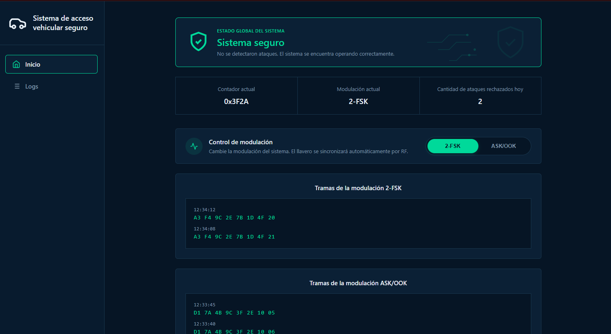
  
<em>Figura 1: Vista principal del panel de monitoreo y estado de seguridad.</em>

  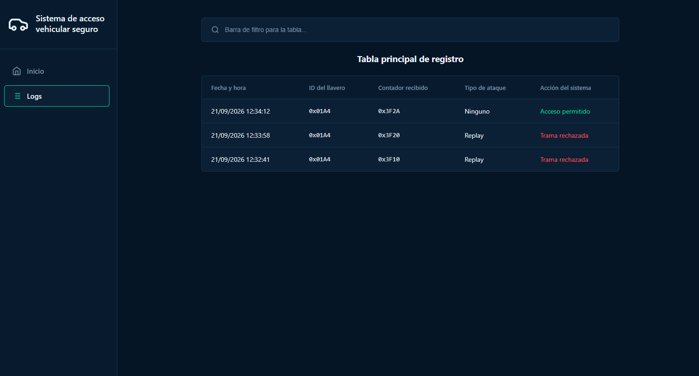
  
<em>Figura 2: Vista de la tabla de registros.</em>

 #### **Fecha 25/09/2026** 
- Qué se hizo?

   -  Implementación completa de la arquitectura del backend local utilizando Python y Flask.

   - Configuración de la base de datos relacional con SQLite para el almacenamiento persistente del historial de eventos,id del llavero, contador, tramas, rssi, contadores y tipos de ataque.

   - Desarrollo de la comunicación bidireccional integrando la librería Flask-SocketIO para conectar el servidor directamente con la interfaz web.

   - Desarrollo del script simulador.py. Este código se encarga de enviar datos crudos (tramas, modulación y la acción del sistema) hacia el backend para testear que la comunicación funcione y ver cómo se llenan las tablas de la interfaz automáticamente.

   - Se rediseñó la estructura de la tabla en la vista de Logs. Se añadieron las columnas "Trama (Hex)" y "Modulación", solucionando la imposibilidad previa de rastrear la trama exacta de un registro pasado.

   - Se rediseñó la estructura de la tabla en la vista de Inicio. Se añadieron las columnas RSSI(dBm) y Resultado para tener mas informacion de esa trama y que paso con ella, si fue aceptada o rechazada.

   - Limpieza de las vistas HTML, borrando todos los datos estáticos de prueba que estaban en los <tbody> para que la página dependa 100% de la información del servidor.

- Decisión tomada

   - Se consideró y evaluó utilizar peticiones HTTP asincrónicas para actualizar los datos de la página web. Sin embargo, se decidió implementar WebSockets porque los cambios visuales en el panel se ven mucho más fluidos. Además, a nivel de red, evita saturar el procesamiento del sistema al eliminar la necesidad de consultar la base de datos constantemente.

   - Se definió un comportamiento visual de alerta en el frontend: cuando el sistema detecta un Replay Attack (inyectado ahora mediante el simulador), la pantalla del dashboard se pone de color rojo para evidenciar la vulneración.

- Próximo paso 
   - Arrancar con el desarrollo del firmware en C++ para el ESP32 receptor usando el entorno PlatformIO.

   - Estructurar la librería mbedtls para el descifrado AES-128 y programar la máquina de estados que va a atajar las cuatro zonas del Rolling Code (Ataque, Tolerancia, Resincronización Lógica y Resincronización Física).

   

   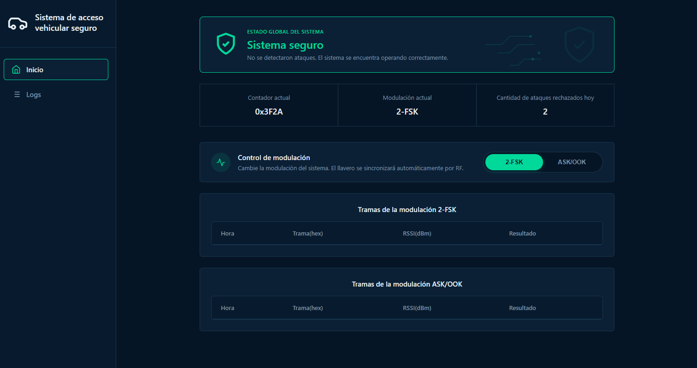
   
<em>Figura 1: Pantalla de inicio con las tablas rediseñadas.</em>

   

   

   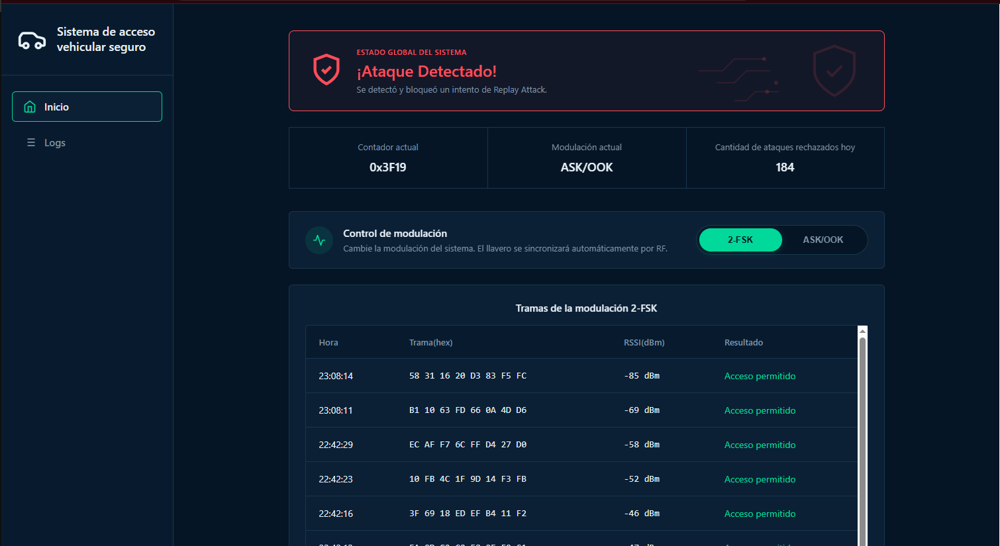
   
<em>Figura 2: Pantalla de inicio con alerta de replay attack </em>

   

   

   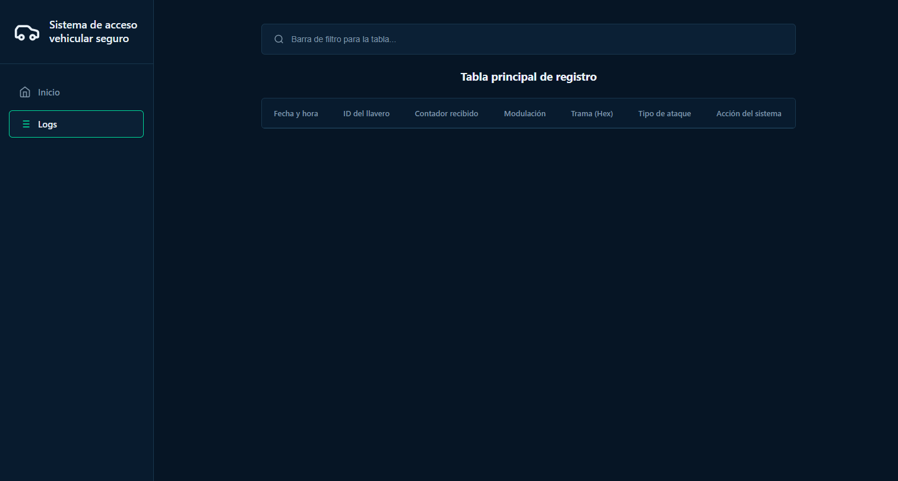
   
<em>Figura 3: Pantalla de logs con las tablas rediseñadas.</em>

   

   

   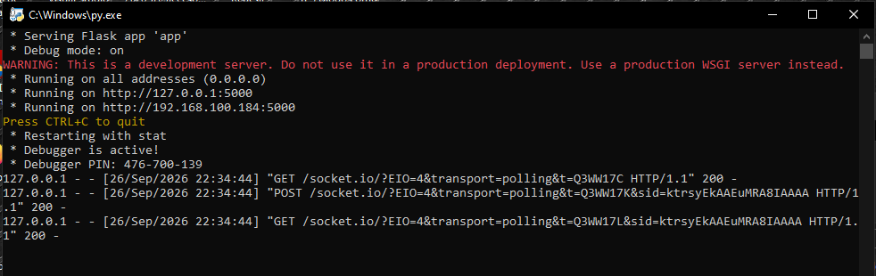
   
<em>Figura 4: Servidor en funcionamiento.</em>

   

   

   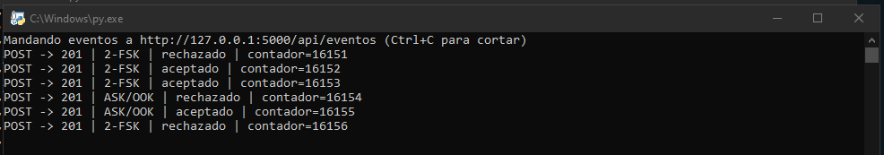
   
<em>Figura 5: Simulador de pruebas en funcionamiento.</em>

   

#### **Fecha 26/09/2026** 

- Qué se hizo? 

   - En primer lugar se investigaron las distintas plataformas de desarrollo para microcontroladores ESP8266, ESP32 y Arduino (PlatformIO y ArduinoIDE).

   - Luego se desarrollaron los códigos base y las configuraciones iniciales tanto para el nodo emisor (node_emisor) como para el nodo receptor (node_receptor).

   - Se puedo testear y verificar con éxito la compilación del entorno con los códigos iniciales, asegurando el empaquetado exacto de la trama de 16 bytes y las librerías criptográficas, aunque aún resta probar su funcionamiento directo sobre HW físico.

   - Se estructuró e integró la carpeta de firmware dentro del repositorio, creando una rama de trabajo aislada llamada 'Prueba' para resguardar la rama main. Para asi poder probar y testear código de manera independiente.
   
- Decisión tomada 

   - Se optó por PlatformIO ya que resulta ser mucho más flexible que el IDE tradicional de Arduino para manejar múltiples arquitecturas en un mismo workspace.
   - Se optó por desarrollar el código base estructurando los entornos por separado y utilizando un diseño modular para garantizar la sincronización de las comunicaciones y la gestión de ventanas de códigos rodantes.

- Problemas encontrados y solución
   - Incompatibilidad con los includes y headers de la librería CC1101: Inicialmente se pensaba que la librería del transceptor podía manejarse con la inclusión genérica estándar, pero al revisar el sitio oficial de platformIO (https://registry.platformio.org/libraries/lsatan/SmartRC-CC1101-Driver-Lib), se constató que requiere una directiva y un archivo de compatibilidad específicos.
      -  Solución: Se ajustaron los includes en el código utilizando la estructura requerida por el driver oficial:
         - #include <SmartRC_CC1101.h>
         - #include "ELECHOUSE_CC1101_SRC_DRV.h>

- Próximo paso 

   - Recibir los componentes físicos del kit
   - Ensamblar la arquitectura
   - Probar el código inicial compilado directamente en el HW
   - Corregir posibles errores de integración y continuar con el desarrollo y calibración de la lógica de radiofrecuencia ya contando con los nodos.

#### **Fecha 06/10/2026** 

- Qué se hizo? 

   - Se recibieron los materiales de trabajo.

   - Luego se procedió a conectar los respectivos MCU con sus módulos de radiofrecuencia para poder probar los códigos realizados anteriormente.

   - Se configuró la placa WeMOS D1 para poder trabajar con ella (Se tuvo que descargar un driver especifico para que se reconocieron el puerto COM. Fuente: https://www.wemos.cc/en/latest/ch340_driver.html).

   - Se validó el funcionamiento de los componentes mediante la utilización de cables de alimentación y cables dupont.

- Problemas encontrados 
   - Los códigos de prueba subidos anteriormente arrastraban errores relacionados al módulo CC1101 principalmente en sus registros de configuración e inicialización. Se investigaron mas en profundidad los campos de configuración del módulo cc1101 y se tomo como referencia los ejemplos de https://registry.platformio.org/libraries/lsatan/SmartRC-CC1101-Driver-Lib/examples adaptandolos a nuestro programa.
Dichos campos (Algunos modificados y otros nuevos) son los siguientes:

    //Indica a la librería que pines se usaran para el BUS SPI con el CC1101
    setSpiPin(D5, D6, D7, D8); 

    // Inicializa el CC1101 (Lo reinicia y lo pone en un estado conocido)
    Init();

    // Modo de paquetes FIFO
    // 0 -> Modo Asincrónico, 1 -> Modo de paquetes FIFO
    setCCMode(1);

    // Ambos CC1101 en exactamente la misma configuración
    setModulation(0);   // 2-FSK
    setMHZ(433.92);

    // Configuración de paquetes NUEVO
    setSyncMode(2);
    setCrc(1);

    //Pone el chip en modo transmisión o recepción
    SetTx();

Si bien se realizaron modificaciones, el codigo todavia no funciona. Los módulos de radiofrecuencia logran comunicarse entre si, pero la información entrante es incorrecta.

- Próximo paso 

   - Continuar con la programación
   - Solucionar y corregir errores tanto en emisor como receptor
   - Realizar pruebas y testeos para validar el correcto funcionamiento de los mismos
 
#### **Fecha 07/10/2026** 

- Qué se hizo? 

   - Se continuo con la configuración y comunicación inicial de los nodos emisor y receptor.
   - Se lograron resolver detalles de la inicialización y sincronización de los mismos para poder realizar la primera comunicación (Se adjunta una foto).
  
     

- Problemas encontrados
   - Mal seteado los bits en los registros de modulación.
   - Diferencias entre las configuraciones iniciales de ambos nodos --> Ambos deben de llevar la misma configuración inicial.

- Próximo paso
   - Conectar el botón al emisor y configurar la interrupción para simular la apertura y cierre del "auto".
   - Profundizar el desarrollo del código aplicando conceptos de "Deep Sleep" y "Wake-on-Radio" (WoR), en emisor y receptor respectivamente.
   

### **Fecha 16/10/2026**
- ¿Qué se hizo?
   - Se mejoró la estructura del firmware: se pasó de un proyecto de PlatformIO por nodo a un único proyecto con tres entornos (llavero, auto y atacante), uno por nodo. Para programar un nodo alcanza con seleccionar el entorno correspondiente, y PlatformIO compila solo el código de esa placa.
   - Organización de las carpetas del proyecto:

     Firmware/
     ├── platformio.ini     (los 3 entornos)
     ├── lib/               código compartido entre los nodos
     ├── data/              web (HTML, CSS y JS) que se aloja en la memoria del ESP32
     └── src/
         ├── llavero/       código del nodo emisor
         ├── auto/          código del nodo receptor
         └── atacante/      código del nodo interceptor
   
         Dentro de cada carpeta de `src/` hay archivos `.cpp` y `.h`. Al seleccionar el entorno se compila y se carga en el microcontrolador únicamente el contenido de su carpeta.

   - Se cambió la forma de servir la web. Antes el ESP32 solo alojaba los archivos estáticos y los servía con ESPAsyncWebServer; para ver la página se conectaba una notebook al WiFi del propio ESP32, y además había que ejecutar un servidor (Flask) que se comunicaba con el servidor local del ESP32, recibía los datos y actualizaba la web mediante WebSocket. Ahora todo queda en el ESP32: sube los archivos estáticos del frontend y actualiza la web con los datos. La PC solo sirve para visualizar la página y, desde la misma, se puede realizar el cambio de modulación.
   - Se modularizó el código del receptor: la configuración WiFi y el servidor quedaron en archivos separados.

- Problemas encontrados y solución
   - Con la arquitectura anterior, la web dependía de dos dispositivos (el ESP32 y la PC con el servidor Flask) para actualizarse.
   - Solución: se pasó toda la lógica del servidor al ESP32. El backend en Flask y el simulador se conservan en el repositorio (carpetas Web/backend y Tests) como herramienta de pruebas.

- Próximo paso
   - Continuar completando la funcionalidad del receptor.
   - Separar en la carpeta lib las configuraciones comunes entre los nodos (configuración de la radio y RF del CC1101).
   - Cifrado de la trama.
   - Funcionalidad del servomotor.
   - Estados de seguridad.

- Fecha 17/10/2026
- ¿Qué se hizo?
   - Se completó el main.cpp del receptor (auto) con la configuración del CC1101, el Access Point, el servidor web y el WebSocket.
   - Se creó la librería radio_cc1101 en lib/. La configuración del CC1101 quedó separada del main.cpp en cc1101_config (perfil 2-FSK a 433,92 MHz, que ya habíamos probado, y perfil ASK/OOK). Las funciones de envío y recepción de tramas de 16 bytes están en radio_cc1101: la recepción informa el RSSI y el resultado del CRC de cada trama, y devuelve un resultado (trama válida, CRC incorrecto, longitud incorrecta o desborde de la FIFO). También se agregó rx_start_wor() para escuchar en bajo consumo con Wake-On-Radio (pendiente de validar con el hardware).
   - Se creó la librería crypto-aes en lib/ con el cifrado y descifrado AES-128 (modo ECB, mbedtls). El receptor descifra la trama, extrae el ID de 4 bytes y el contador, y valida el ID antes de procesar el contador.
   - Se implementó la validación de los estados de seguridad, definidos como enum en el archivo estados_seguridad.h:
      - Acceso permitido: el contador recibido está entre +1 y +6 respecto del último válido.
      - Rechazo por Replay Attack: el contador es menor o igual al último válido.
      - Alerta de resincronización lógica: salto de +7 a +50.
      - Rechazo por desincronización: salto mayor a +50 (requiere emparejamiento físico).
      - ID inválido: la trama pertenece a otro llavero.
   - El último contador válido se guarda en la memoria NVS del ESP32, y cada evento registrado incluye el RSSI de la trama.
   - Se creó un archivo con la funcionalidad del servomotor: abre a 90° y cierra a 0°. La puerta se mantiene abierta 3 segundos controlando el tiempo con millis(), para no bloquear el programa mientras tanto.
   - Se mantiene un modo de prueba por puerto serie (tramas de 16 bytes en hexadecimal) para usar con test_receptor.py.
   - El firmware del receptor (entorno auto) compila correctamente.

- Problemas encontrados y solución
   - Con la versión anterior del envío y la recepción de datos entre el llavero y el receptor, que usaba las funciones SendData() y ReceiveData() propias de ELECHOUSE, se encontró un inconveniente.
      - Problema identificado: Durante las pruebas del proyecto, se analizó el funcionamiento de las funciones SendData() y ReceiveData() de la biblioteca ELECHOUSE para el módulo de radiofrecuencia CC1101, utilizado para la comunicación inalámbrica entre los nodos del sistema. Si bien estas funciones permiten realizar transmisiones y recepciones de datos, se identificaron algunas limitaciones para los requerimientos de nuestro proyecto. En particular, necesitábamos obtener información sobre la calidad de la señal recibida, controlar los tiempos de espera y detectar posibles errores en las tramas intercambiadas. El principal inconveniente se encontraba en la recepción. La función ReceiveData() lee los datos de la trama y, posteriormente, descarta los dos bytes de estado que el CC1101 agrega al final del paquete recibido. Estos bytes contienen información importante: el primero corresponde al valor de RSSI de esa trama y el segundo incluye el indicador de validez del CRC y la información LQI. Como consecuencia, al utilizar la función original se pierde el RSSI asociado específicamente al paquete recibido. Aunque la biblioteca dispone de la función getRssi(), esta consulta el registro de señal del momento en que se realiza la lectura, por lo que el valor obtenido no garantiza corresponder a la trama que se acaba de recibir. Esta limitación resulta relevante para nuestro sistema, ya que buscamos registrar la intensidad de señal de cada comunicación y mostrarla en la interfaz web para facilitar el seguimiento y diagnóstico de los intercambios entre los nodos, para detectar los posibles ataques de Jamming. También se identificaron limitaciones en la gestión de los tiempos de espera y en la detección de errores. La implementación original utiliza esperas bloqueantes y depende del pin GDO0 para determinar el final de la transmisión. Sin embargo, nuestro código no configuraba explícitamente dicho pin, por lo que esta espera podía finalizar al alcanzar el tiempo límite sin detectar correctamente el evento esperado. Por último, el mecanismo original no permitía distinguir de manera suficientemente clara entre una recepción normal, una trama de longitud incorrecta, un error de CRC o un desbordamiento de la FIFO de recepción.
      - Solucion:
         - A partir de los problemas identificados, se decidió conservar la configuración de radiofrecuencia que ya se encontraba probada en los nodos emisor y receptor, y modificar únicamente la gestión de la transmisión y la recepción. Se mantuvieron los parámetros de configuración de la biblioteca ELECHOUSE: modo de comunicación, modulación 2-FSK, frecuencia de 433,92 MHz, velocidad de transmisión de 1,2 kBd, desviación de frecuencia, ancho de banda de recepción, canal, sincronización y CRC por hardware. De esta manera, se evita introducir cambios innecesarios en los parámetros de comunicación y se mantiene la compatibilidad de las tramas con la implementación anterior. En lugar de depender exclusivamente de SendData() y ReceiveData(), se desarrolló una capa propia dentro de la biblioteca del proyecto radio_cc1101. Esta capa accede directamente a los registros y a las FIFO del CC1101 para gestionar los paquetes y recuperar la información de estado que antes se descartaba. La nueva implementación incorpora funciones específicas para iniciar una transmisión, consultar su estado, iniciar la recepción y procesar los paquetes recibidos. Además, se establecen tiempos límite para evitar esperas indefinidas.
         - Modificaciones realizadas:
            - Gestión de la transmisión: Se incorporaron las funciones tx_start() y tx_poll(), junto con send_blocking() como alternativa de envío con espera limitada. La función tx_start() prepara el módulo para transmitir: lo lleva al estado IDLE, vacía la FIFO de transmisión, escribe el byte de longitud del paquete y los datos correspondientes, y finalmente ejecuta el comando de transmisión STX. Por su parte, tx_poll() permite consultar el estado interno del CC1101 mediante el registro MARCSTATE. De esta manera, se puede determinar si el módulo continúa transmitiendo, si ha finalizado y regresado al estado IDLE o si se produjo un error de subdesbordamiento de la FIFO. La función send_blocking() utiliza este mecanismo de consulta repetida, pero con un tiempo límite calculado a partir de la duración estimada de la trama. Así, se evita depender del pin GDO0 para detectar el final de la transmisión. Esta separación permite disponer de un mecanismo de consulta que no necesita bloquear durante toda la transmisión y, al mismo tiempo, conservar una función de envío sencilla para los casos en los que se necesita esperar el resultado antes de continuar.
            - Gestión de la recepción: Para la recepción se incorporaron las funciones rx_start() y rx_poll(). La función rx_start() lleva el módulo al estado IDLE, limpia la FIFO de recepción mediante el comando SFRX y vuelve a activar el modo de recepción con SRX. Esto permite iniciar una nueva escucha sin conservar datos anteriores. La función rx_poll() consulta el registro RXBYTES para conocer la cantidad de bytes disponibles en la FIFO. La lectura se realiza dos veces hasta obtener valores coincidentes, debido a que el contenido puede cambiar mientras el módulo recibe información. A partir de esa lectura, se contemplan diferentes situaciones:
               - Recepción válida: se obtiene una trama de la longitud esperada, se recuperan sus datos y se comprueba el estado del CRC.
               - Longitud incorrecta: la longitud recibida no coincide con los 16 bytes de datos definidos para nuestro protocolo.
               - CRC incorrecto: el indicador de estado informa que la trama no superó la comprobación de integridad.
               - Desbordamiento de FIFO: se detecta que la memoria de recepción se ha desbordado y es necesario recuperarla.
               - Sin datos disponibles: el módulo continúa esperando una trama sin bloquear el ciclo principal del programa.
            Los resultados se representan mediante los estados NONE, FRAME, BAD_CRC, BAD_LENGTH y FIFO_OVERFLOW. La función rx_poll() permite consultar periódicamente si se recibió una trama, en lugar de depender de una espera fija con delay(). Esto facilita la integración con una arquitectura de firmware basada en un ciclo principal cooperativo. Como regla de funcionamiento, cuando rx_poll() devuelve un resultado distinto de NONE, el módulo queda en estado IDLE y se debe llamar nuevamente a rx_start() para reanudar la escucha. 
            - Recuperación del RSSI por trama Una de las modificaciones más importantes consiste en conservar los dos bytes de estado que el CC1101 agrega a la FIFO de recepción cuando está habilitada la opción APPEND_STATUS. Para una trama con 16 bytes de datos, la FIFO de recepción contiene 19 bytes: un byte de longitud, 16 bytes de datos y dos bytes de estado. El primer byte de estado contiene el RSSI de la trama recibida. El segundo contiene el indicador CRC_OK en su bit más significativo y los bits correspondientes a LQI. El RSSI se calcula convirtiendo el byte recibido a un valor con signo y aplicando la fórmula utilizada por la biblioteca:
               - Si el valor sin signo es menor que 128, se utiliza directamente.
               - Si es mayor o igual que 128, se le resta 256.
               - Finalmente, se divide el resultado por dos y se resta 74 para obtener el valor aproximado en dBm.
            - Este procedimiento permite asociar la intensidad de señal a la trama concreta que se procesó, en lugar de consultar una medición independiente del canal. El valor calculado se entrega junto con los datos recibidos para que pueda utilizarse en el registro de eventos y visualizarse posteriormente en la interfaz web, en la columna RSSI (dBm). Debe tenerse en cuenta que el resultado es una aproximación y que el desplazamiento aplicado depende de los parámetros de funcionamiento del receptor. Por lo tanto, su precisión debe comprobarse mediante pruebas con el hardware real.
            - Esta solucion mejora el control sobre la comunicación inalámbrica y proporciona información útil para diagnosticar problemas de transmisión y recepción. En particular, permite:
               - Registrar el RSSI asociado a cada trama recibida.
               - Identificar errores de integridad mediante el indicador de CRC.
               - Detectar paquetes de longitud incorrecta y desbordamientos de la FIFO.
               - Controlar los tiempos de espera de la transmisión.
               - Consultar periódicamente el estado del módulo sin depender de esperas bloqueantes en la recepción.
               - Mantener el formato de las tramas y la configuración de radio ya utilizadas por los nodos.
            La información de RSSI puede incorporarse al registro de eventos del sistema y utilizarse para analizar cómo varía la intensidad de señal cuando cambia la distancia entre los módulos. En conclusión, el cambio de implementación busca adaptar la comunicación del CC1101 a las necesidades del Sistema de Acceso Vehicular Seguro, conservando la configuración y el formato de los paquetes existentes, pero incorporando un control más preciso de la transmisión, la recepción y la información de diagnóstico.
- Próximo paso
   - Dejar terminado el receptor, puliendo detalles como la resincronización y la máquina de estados.
   - Agregar el código del emisor, adaptándolo a los nuevos cambios de comunicación con el receptor.
   - Mejorar el responsive de la web, para poder visualizar mejor desde el movil.

   

   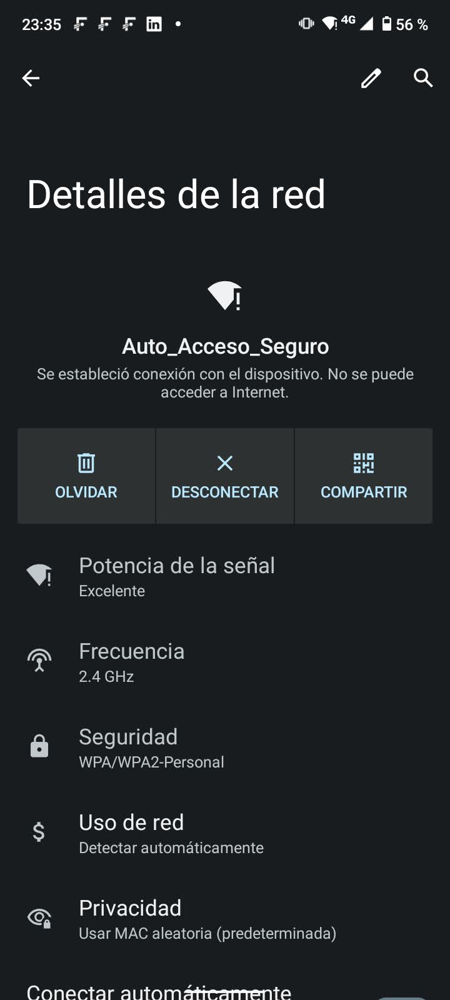
   
<em>Figura 6: vista de la red WiFi.</em>

   

   

   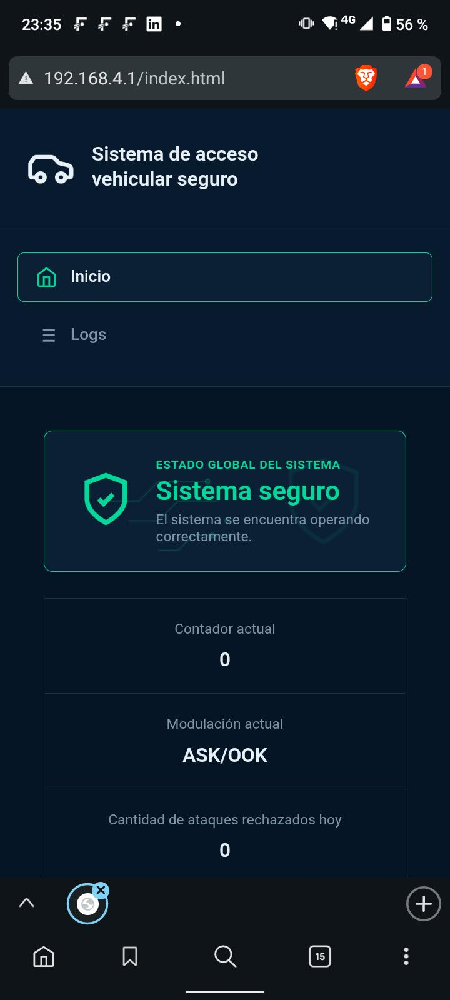
   
<em>Figura 7: vista de inicio de la web desde movil.</em>

   

   

   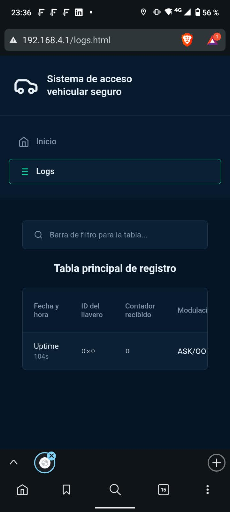
   
<em>Figura 8: vista de logs de la web desde movil.</em>

   

   

   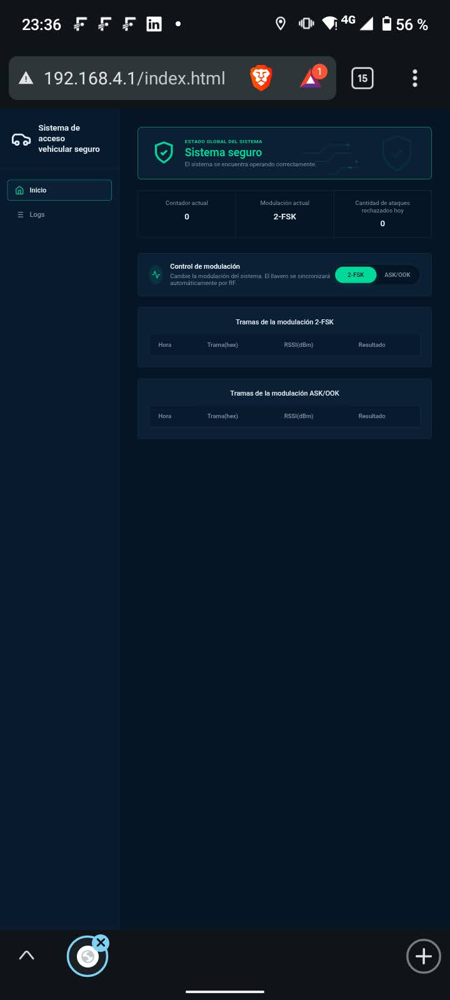
   
<em>Figura 9: vista de inicio de la web desde movil en modo PC.</em>

   

   

   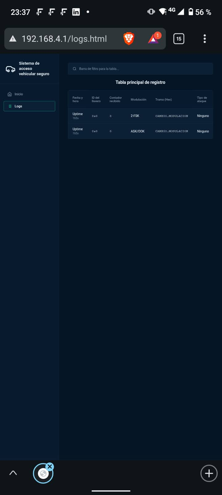
   
<em>Figura 10: vista de logs de la web desde movil en modo PC.</em>

   

